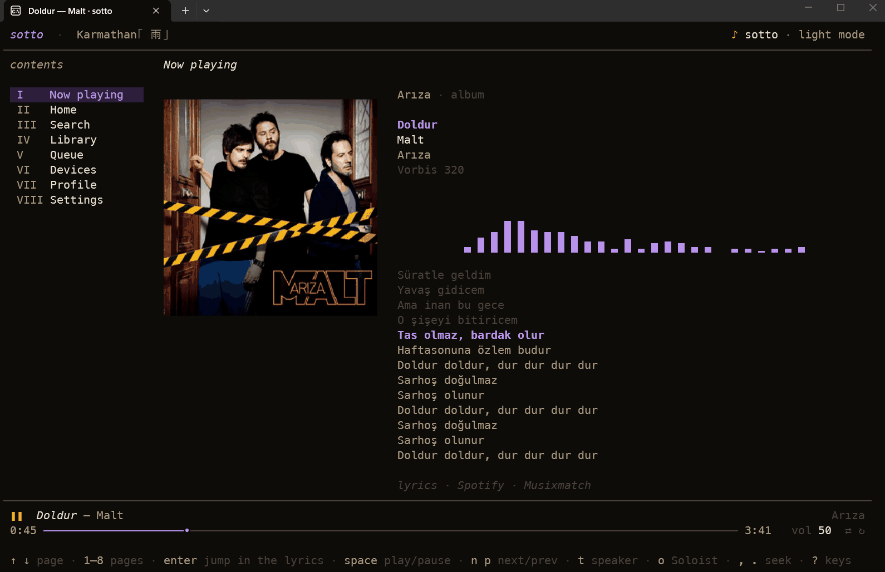
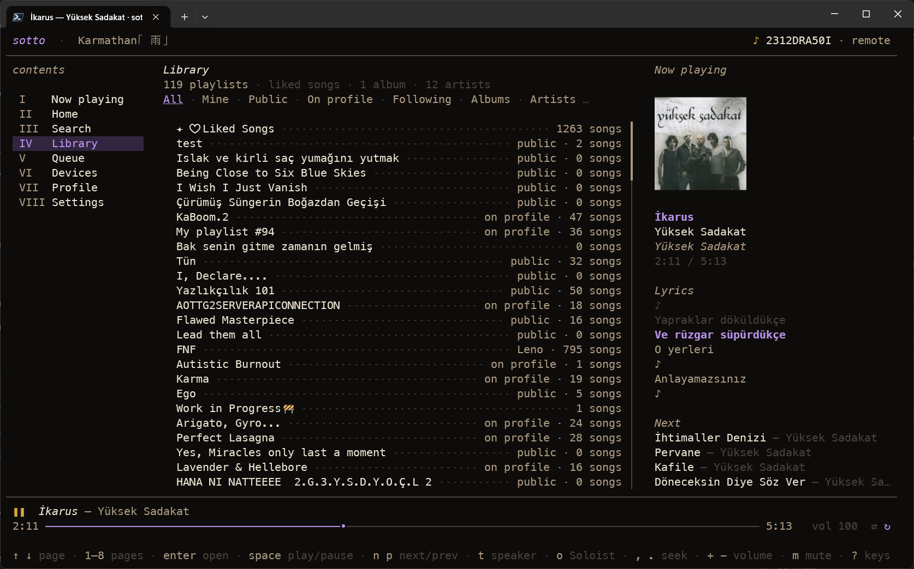
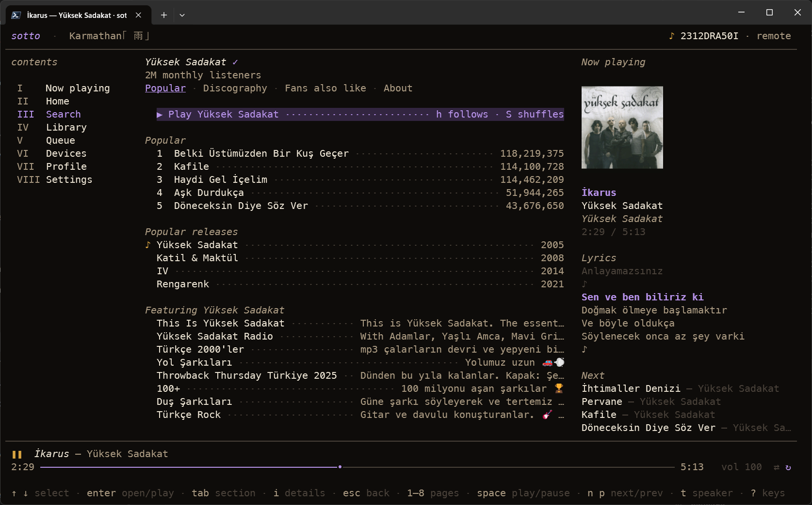
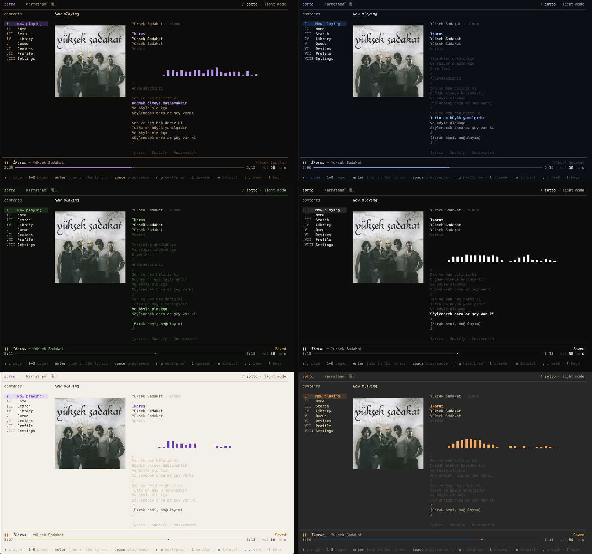
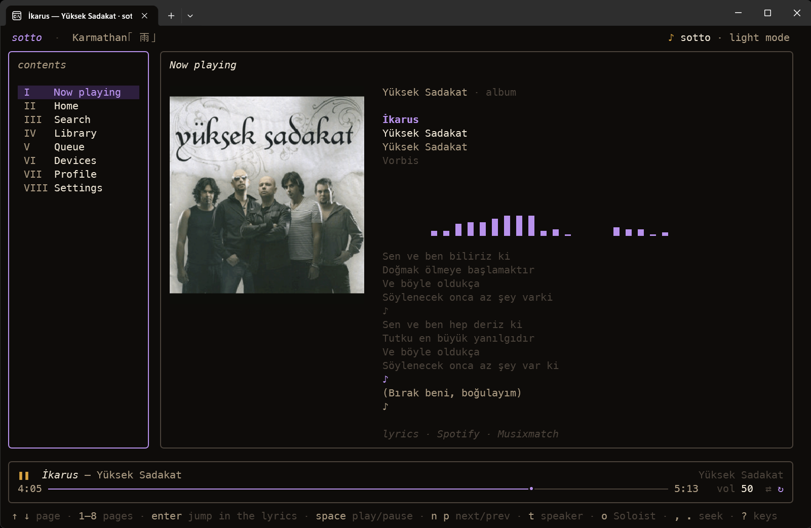

<p align="center">
  
</p>

<h1 align="center">sotto</h1>

<p align="center">A good-looking, full-featured Spotify TUI.</p>

<p align="center">
  
</p>

I wanted to use Spotify from the terminal without keeping the Spotify app open. sotto plays the music itself through Spotify Soloist, Spotify's own small player with no window. It can also control the Spotify app, your phone or any other Spotify Connect device.

## Why sotto

Most terminal Spotify clients play audio through librespot, and at the time of writing librespot can't play Spotify's audio (see [librespot#1649](https://github.com/librespot-org/librespot/issues/1649)). sotto uses Soloist, which Spotify publishes for developers, so the sound comes from Spotify itself.

## Features

- Plays on this computer through Soloist, or controls any Spotify Connect device. `t` moves the music between them.
- Library with playlists, folders, pinned playlists, albums, artists and podcasts. Sorting and in-list search.
- Search with a best result, artist pages with the full discography, album credits, and a listening history with stats.
- Playlists: create, edit, delete, add and remove songs, move songs up and down, import a list of songs from a file.
- Queue editing: remove, reorder or clear the queue.
- Synced lyrics, from Spotify or LRCLIB. `enter` on a line jumps there.
- Radio, recommended songs at the end of your playlists, and hiding songs.
- A side panel in wide windows keeps the song, its cover, the lyrics and the queue in view on every page.
- Album covers as real images on terminals with Sixel, such as Windows Terminal and WezTerm, and as pixel art everywhere else.
- 13 themes, plus your own: `sotto theme import` turns an iTerm2, Alacritty or Windows Terminal colour scheme into a sotto theme.
- An audio visualizer, full screen with `V`.
- Every key can be changed in `keymap.toml`, with sequences such as `g l` and counts such as `5j`.
- Media keys and the system media card on Windows, MPRIS on Linux. Song notifications and Discord status.
- A command line (`sotto next`, `sotto play daft punk`) and an MCP server for AI assistants.
- English and Turkish.

## Screenshots

<p align="center">
  
</p>

<p align="center">
  
</p>

<p align="center">
  
</p>

<p align="center">
  
</p>

## Requirements

- Spotify Premium. The setup wizard does the rest.
- Windows 10 or 11, or Linux (x86_64 or arm64). macOS has not been tried: Soloist exists for Apple Silicon only, and the extras don't work there.

## Install

On Windows, with winget:

```powershell
winget install sotto
```

Or with [Scoop](https://scoop.sh):

```powershell
scoop bucket add ehtisam https://github.com/Ehtisam/scoop-bucket
scoop install sotto
```

Or download the archive for your system from [Releases](https://github.com/Ehtisam/sotto/releases) and unpack it.

On Windows, run `sotto.exe` from Windows Terminal. On Linux:

```sh
tar xzf sotto_0.1.0_linux_x86_64.tar.gz
./sotto
```

`checksums.txt` has the SHA-256 of every file.

With Go 1.27 or newer you can also build it yourself:

```sh
go install github.com/Ehtisam/sotto/cmd/sotto@latest
```

## Setup

The first time sotto opens, a setup wizard walks you through three things. It takes a few minutes.

1. **Your own Spotify app.** Spotify lets programs like sotto in only through an app of your own, made for free on the [developer dashboard](https://developer.spotify.com/dashboard). `ctrl+o` opens the dashboard and copies the Redirect URI. When you copy the Client ID on the site, sotto picks it up from the clipboard by itself. Because the app is yours, Spotify's request limits apply to you alone.
2. **Soloist.** For music on this computer, sotto needs a Soloist key, which you also get for free on the developer dashboard. sotto then downloads Soloist from Spotify. Each Soloist build works for 90 days, and sotto downloads the new one before that. The first time only, pick "sotto" from the device list in the Spotify app on your phone or another computer on the same Wi-Fi.
3. **Extras.** Lyrics from Spotify, radio, recommendations, queue editing, hiding songs and friend activity use Spotify endpoints that are not public. sotto reaches them through [go-librespot](https://github.com/devgianlu/go-librespot), which it downloads on its own. They are optional and can stop working if Spotify changes something.

You can skip Soloist. sotto then works as a remote for the Spotify app or your phone. `sotto setup` opens the wizard again, and `sotto doctor` checks the setup.

## Keys

| Key | |
| --- | --- |
| `1` to `8` | pages |
| `/` | search Spotify |
| `space` | play or pause |
| `n` `p` | next, previous |
| `,` `.` | seek back, forward |
| `+` `-` | volume |
| `a` | actions for the selected item |
| `t` | move the music between Soloist and another device |
| `l` | lyrics or the queue on Now playing |
| `?` | every key, with a filter |

## Command line

```sh
sotto play daft punk one more time
sotto play random access memories --type album
sotto next
sotto vol +10
sotto queue get lucky
sotto status --json
```

Playback commands go through the open sotto window, or to the active Spotify device when sotto is closed. `sotto help` lists everything, and `sotto completion powershell|bash|zsh|fish` prints a tab-completion script.

## AI assistants

`sotto mcp` is an MCP server. An assistant can search, play, queue songs and make playlists through it. For Claude Code:

```sh
claude mcp add sotto -- sotto mcp
```

## Settings

Everything lives in one file, which Settings (`8`) also edits:

- Windows: `%APPDATA%\sotto\config.toml`
- Linux: `~/.config/sotto/config.toml`

## Linux

Tested on Debian 13 with Xfce: the setup, signing in and starting Soloist work. Media keys use MPRIS. Reading the clipboard needs `xclip` or `wl-clipboard`, and notifications need `notify-send`. sotto puts itself in the app menu, where it opens in your terminal.

## Thanks

sotto stands on [Spotify Soloist](https://developer.spotify.com/documentation/soloist), [go-librespot](https://github.com/devgianlu/go-librespot) (GPL-3.0, downloaded separately and run as its own program), [Bubble Tea and Lip Gloss](https://github.com/charmbracelet) and [LRCLIB](https://lrclib.net).

sotto is not affiliated with Spotify.

License: [MIT](LICENSE)
